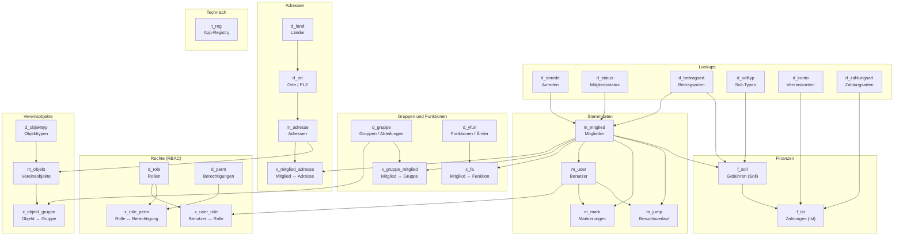
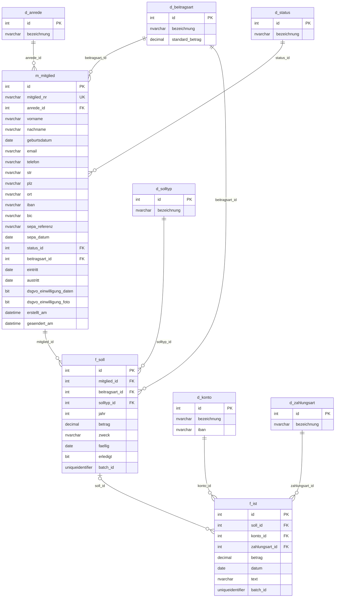
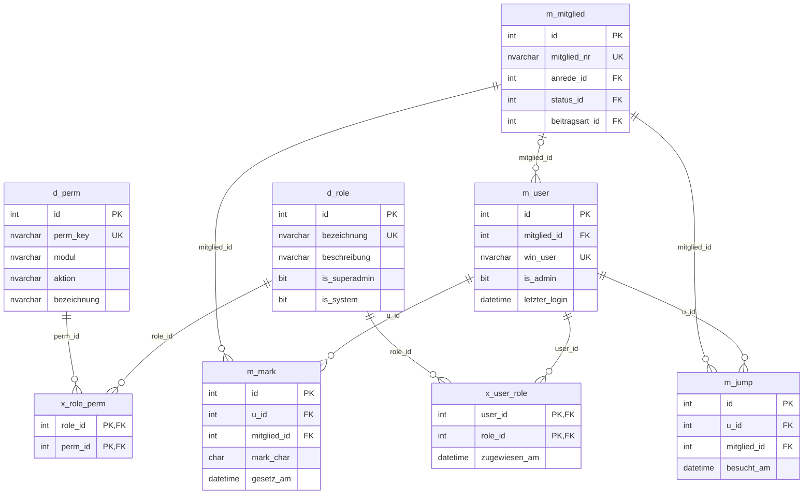
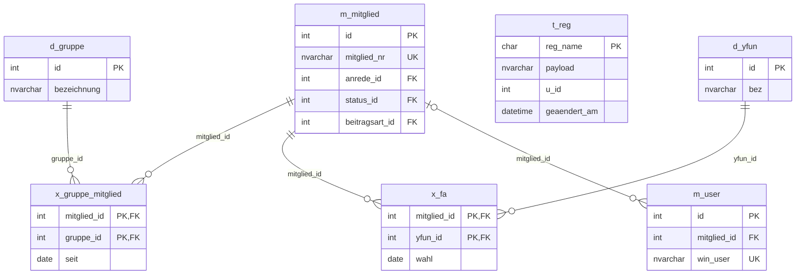
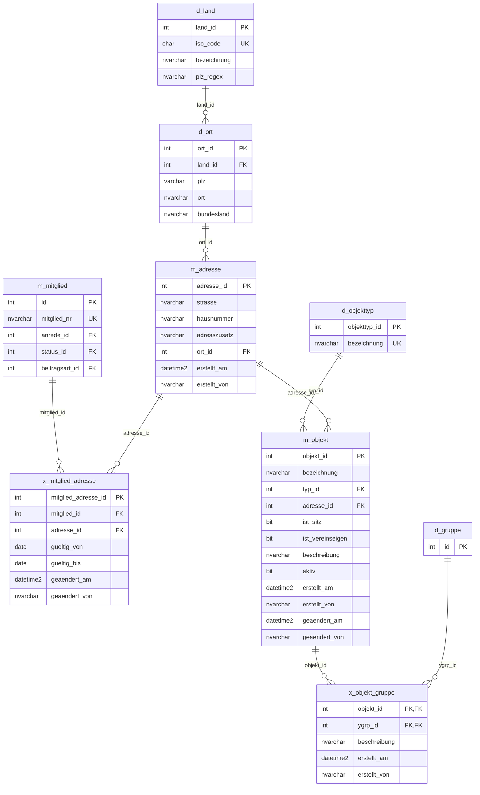
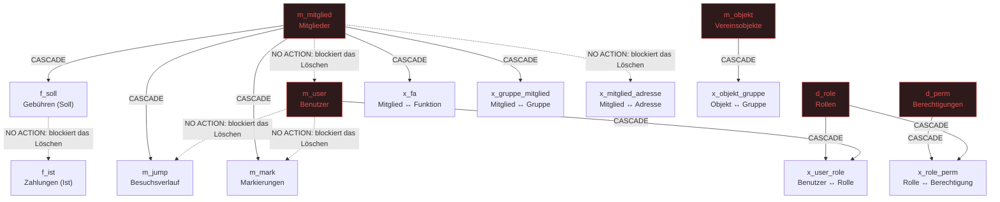

<!-- schema-diagramme.md — v2.0.0 — Neuaufbau aus dem Datenbankprojekt: 28 Tabellen, neue Gruppe Adressen/Vereinsobjekte, Löschverhalten berechnet -->
<!-- erzeugt mit tools/schema_extract.py 1.0.0 und tools/schema_render.py 1.0.0; Diagramme sind Mermaid -->

# yam3 — Datenbankschema-Diagramme

Schema: `[yam3]` | Quelle: Datenbankprojekt `yam2.Database`, Branch `feature/gruppe-sitzspalte-entfernen`, Stand `d1dfd1b` | Stand: 2026-10-07

Die Beschreibung der Tabellen und Spalten steht in `schema.md`. Dort steht auch die Zuordnung alter zu neuen Namen.

---

## 1. Gesamtübersicht (Tabellengruppen, Pfeil = „wird referenziert von“)

---

## 2. Kern-Entitäten: Mitglieder, Gebühren, Zahlungen

---

## 3. Benutzerverwaltung und RBAC

---

## 4. Gruppen, Funktionen und technische Tabellen

---

## 5. Adressen und Vereinsobjekte

---

## 6. Löschverhalten (CASCADE und blockierende Verweise)

---

## 7. FK-Referenzmatrix

| Von | Spalte | → Nach | ON DELETE |
|---|---|---|---|
| `d_ort` | `land_id` | `d_land.land_id` | NO ACTION |
| `f_ist` | `konto_id` | `d_konto.id` | NO ACTION |
| `f_ist` | `zahlungsart_id` | `d_zahlungsart.id` | NO ACTION |
| `f_ist` | `soll_id` | `f_soll.id` | NO ACTION |
| `f_soll` | `beitragsart_id` | `d_beitragsart.id` | NO ACTION |
| `f_soll` | `solltyp_id` | `d_solltyp.id` | NO ACTION |
| `f_soll` | `mitglied_id` | `m_mitglied.id` | **CASCADE** |
| `m_adresse` | `ort_id` | `d_ort.ort_id` | NO ACTION |
| `m_jump` | `mitglied_id` | `m_mitglied.id` | **CASCADE** |
| `m_jump` | `u_id` | `m_user.id` | NO ACTION |
| `m_mark` | `mitglied_id` | `m_mitglied.id` | **CASCADE** |
| `m_mark` | `u_id` | `m_user.id` | NO ACTION |
| `m_mitglied` | `anrede_id` | `d_anrede.id` | NO ACTION |
| `m_mitglied` | `status_id` | `d_status.id` | NO ACTION |
| `m_mitglied` | `beitragsart_id` | `d_beitragsart.id` | NO ACTION |
| `m_objekt` | `typ_id` | `d_objekttyp.objekttyp_id` | NO ACTION |
| `m_objekt` | `adresse_id` | `m_adresse.adresse_id` | NO ACTION |
| `m_user` | `mitglied_id` | `m_mitglied.id` | NO ACTION |
| `x_fa` | `mitglied_id` | `m_mitglied.id` | **CASCADE** |
| `x_fa` | `yfun_id` | `d_yfun.id` | NO ACTION |
| `x_gruppe_mitglied` | `mitglied_id` | `m_mitglied.id` | **CASCADE** |
| `x_gruppe_mitglied` | `gruppe_id` | `d_gruppe.id` | NO ACTION |
| `x_mitglied_adresse` | `mitglied_id` | `m_mitglied.id` | NO ACTION |
| `x_mitglied_adresse` | `adresse_id` | `m_adresse.adresse_id` | NO ACTION |
| `x_objekt_gruppe` | `objekt_id` | `m_objekt.objekt_id` | **CASCADE** |
| `x_objekt_gruppe` | `ygrp_id` | `d_gruppe.id` | NO ACTION |
| `x_role_perm` | `perm_id` | `d_perm.id` | **CASCADE** |
| `x_role_perm` | `role_id` | `d_role.id` | **CASCADE** |
| `x_user_role` | `role_id` | `d_role.id` | **CASCADE** |
| `x_user_role` | `user_id` | `m_user.id` | **CASCADE** |

